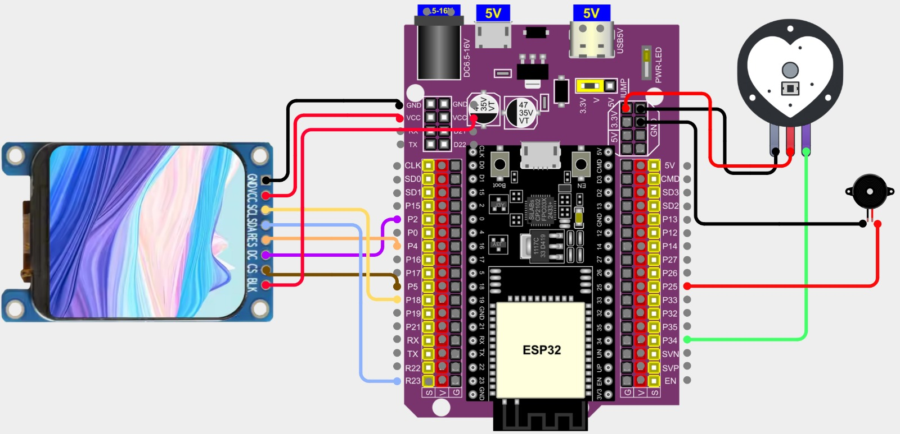

# Monitor de pulso con ESP32, Pulse Sensor y pantalla TFT

Proyecto académico para adquirir una señal fotopletismográfica (PPG) con un Pulse Sensor analógico y visualizarla en una pantalla TFT ST7789. El sistema presenta la forma de onda y las pulsaciones por minuto (BPM). En la segunda versión se añadieron un buzzer y un corazón animado en pantalla, sincronizados con los latidos detectados.

## Objetivo

Integrar el sensor de pulso, el ESP32 y la pantalla TFT en un prototipo que permita observar la señal PPG y las BPM en tiempo real, y comparar la continuidad de la señal bajo distintas condiciones de contacto.

## Versiones

- **Versión 1:** lectura del Pulse Sensor, procesamiento de la señal, visualización de la onda y BPM en la TFT, y representación de la señal procesada en el Serial Plotter.
- **Versión 2:** conserva las funciones de la primera y agrega un buzzer y un corazón animado. Ambos se activan con el evento de latido detectado cuando la calidad de señal es aceptable.

## Componentes

- ESP32 con tarjeta de expansión
- Pulse Sensor analógico
- Pantalla TFT ST7789V3 (240 × 280 píxeles)
- Buzzer piezoeléctrico pasivo (versión 2)
- Cables de conexión y cable USB
- Recubrimiento opaco para sujetar el sensor durante algunas pruebas

## Diagrama de conexiones

El diagrama corresponde al montaje de la segunda versión, que incluye el buzzer. Se elaboró en Cirkit Designer y se incluye aquí para consultar el cableado.

## Conexiones

| Componente | Señal | Pin del ESP32 |
|---|---|---|
| Pulse Sensor | Salida analógica S | GPIO 34 |
| Pulse Sensor | VCC / GND | 3V3 / GND |
| TFT ST7789 | CS | GPIO 5 |
| TFT ST7789 | DC | GPIO 2 |
| TFT ST7789 | RST / RES | GPIO 4 |
| TFT ST7789 | SCLK / SCL | GPIO 18 |
| TFT ST7789 | MOSI / SDA | GPIO 23 |
| TFT ST7789 | VCC / BLK | 3V3 |
| TFT ST7789 | GND | GND |
| Buzzer (V2) | Señal / retorno | GPIO 25 / GND |

La pantalla se comunica por SPI y no requiere conexión MISO en este montaje. El sensor y la pantalla comparten GND con el ESP32.

## Funcionamiento

El ESP32 adquiere la salida analógica del sensor por GPIO 34. La biblioteca **PulseSensor Playground** detecta los eventos de pulso y calcula las BPM a partir del intervalo entre latidos. El programa revisa la amplitud de la señal en ventanas de un segundo y ajusta el umbral cuando se cumplen las condiciones de calidad configuradas. Si se pierde la calidad de señal o dejan de detectarse latidos durante tres segundos, la lectura numérica de BPM se oculta.

La señal PPG se filtra para su representación y se dibuja sobre una cuadrícula en la TFT. En la segunda versión, el mismo evento de latido aceptado inicia el pitido y la animación del corazón. El pitido dura aproximadamente 60 ms y la animación 140 ms.

El Serial Plotter recibe la señal PPG procesada a 115200 baudios. En el sketch incluido, la salida serial contiene la curva PPG; las BPM se muestran en la pantalla TFT.

## Software y bibliotecas

- Arduino IDE
- Paquete de placas **ESP32 by Espressif Systems**
- **Adafruit GFX Library**
- **Adafruit ST7735 and ST7789 Library**
- **PulseSensor Playground**

Abre `PulseSensor_TFT_Buzzer.ino`, selecciona la placa ESP32 correspondiente y el puerto serial. Instala las bibliotecas indicadas desde el Library Manager del Arduino IDE antes de compilar. La velocidad serial del monitor y del Serial Plotter debe configurarse en **115200 baudios**.

## Pruebas realizadas

Se revisó el comportamiento en el dedo con recubrimiento, en el dedo descubierto, con iluminación directa sobre el sensor y en la oreja. Durante las pruebas, el recubrimiento produjo una gráfica más continua y redujo las pequeñas fluctuaciones de las BPM. En el dedo descubierto la lectura se mantuvo, con variaciones leves. La iluminación directa ensayada no produjo cambios grandes frente a la prueba descubierta sin esa iluminación. En la oreja fue necesario cubrir el sensor para obtener una señal continua y lecturas más estables.

Estas pruebas describen el comportamiento observado en el prototipo y no constituyen una validación clínica.

## Repositorio

Este repositorio reúne el código fuente y el diagrama de conexiones del proyecto.
